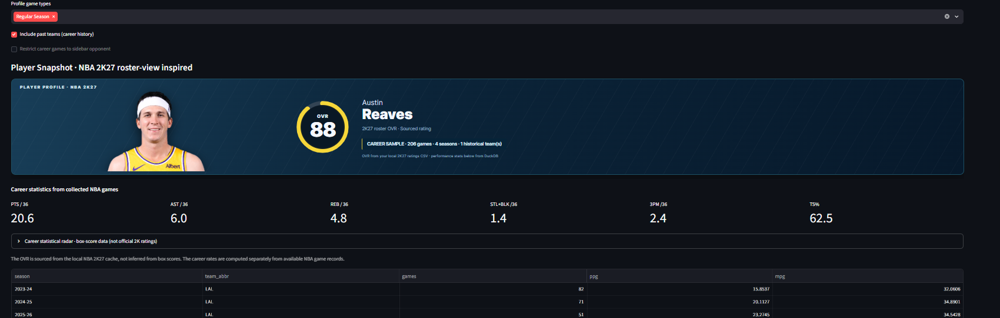
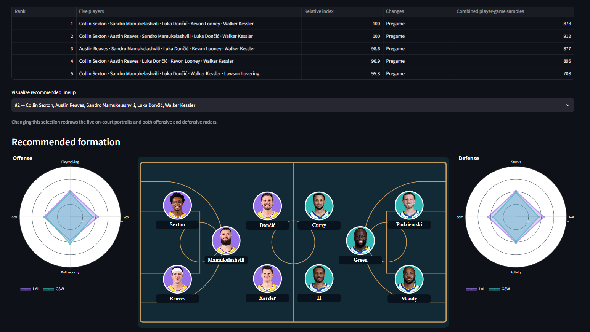
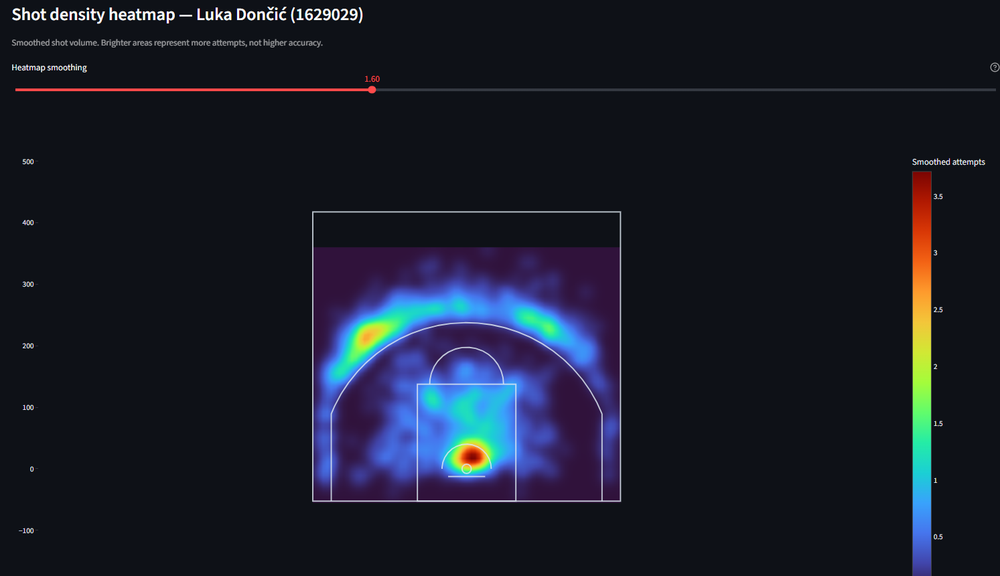
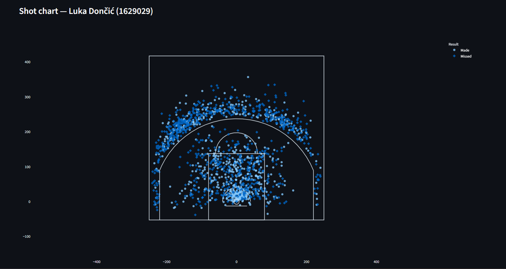
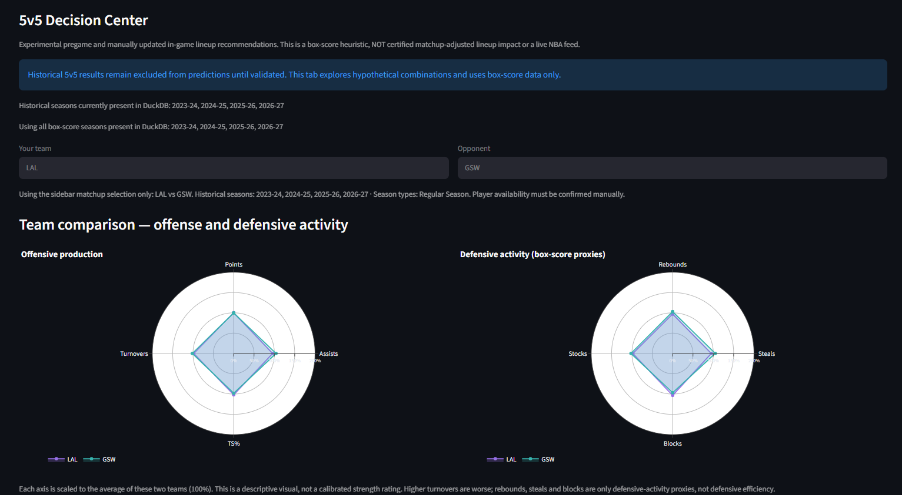
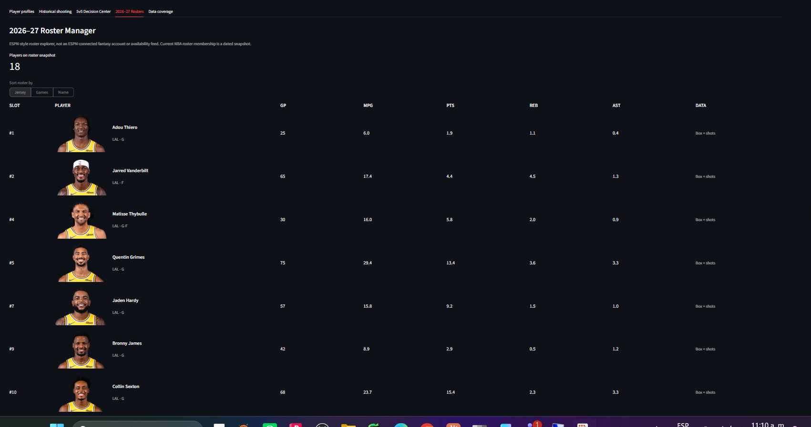
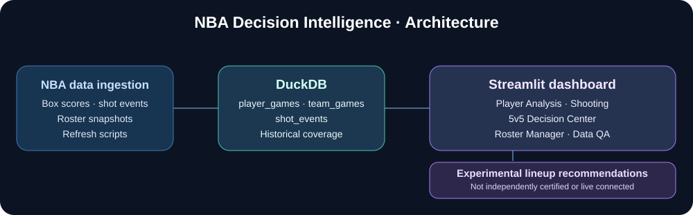

<div align="center">

# 🏀 NBA Decision Intelligence
### Player & Lineup Analysis · Basketball Decision Support

[](https://python.org)
[](https://streamlit.io)
[](https://duckdb.org)


*Multi-season NBA research dashboard with player analytics, shot charts, rosters, and experimental 5v5 lineup recommendations.*
</div>

## Overview

An independent sports analytics portfolio project built with Python, Streamlit, DuckDB and Plotly. Player IDs connect statistics across teams and seasons. Local records cover portions of 2022–23 through 2026–27; completeness varies by season and data type.

> **Research limitations:** The 5v5 rankings use experimental heuristics, not validated five-player impact or calibrated win probabilities. Historical lineup reconstructions are not used as certified training data. Roster snapshots are not real-time injury feeds.

## Explore the dashboard

### Player Analysis



### 5v5 Decision Center



<details>
<summary><strong>More screenshots — shot charts, team comparison, and roster</strong></summary>

#### Shot density heatmap
Brighter areas mean more shot attempts, **not** higher accuracy.



#### Shot chart


#### Team comparison
Box-score proxies, not opponent-adjusted defensive efficiency.



#### 2026–27 Roster Manager

</details>

<details>
<summary><strong>Data architecture</strong></summary>


</details>

## Technology

| Layer | Technology |
|---|---|
| Dashboard | Streamlit |
| Analytics | Python, Pandas, NumPy |
| Historical data | DuckDB |
| Visualizations | Plotly |
| Rosters | Dated local CSV snapshots |
| Ratings display | Externally sourced NBA 2K27 ratings cache |

## Historical data and reproducibility

A verified local snapshot contained **112,708 player-game rows**, **8,586 team-game rows**, and **221,137 shot-event rows**. These are row counts, not unique NBA games. Data collection and shot-location completeness vary across seasons. Historical lineup-stint and player-availability tables were empty in that snapshot.

**The complete historical DuckDB dataset is not included in the repository.** A fresh clone requires an appropriately licensed or authorized data source. Local databases, temporary audits, and credentials are intentionally excluded from Git tracking. NBA game data, photos, logos and third-party ratings may have usage restrictions.

## Run locally — v4.9.2 release branch

```powershell
python -m venv .venv
.\.venv\Scripts\python.exe -m pip install -r requirements.txt
.\.venv\Scripts\python.exe -m streamlit run .\app_decision_v492.py
```

For a read-only deployment-entrypoint test, first provide an authorized snapshot at `deployment/nba_demo.duckdb`, then run:

```powershell
.\.venv\Scripts\python.exe -m streamlit run .\app_decision_cloud.py
```

**Streamlit Community Cloud is not deployed yet.** The planned entrypoint is `app_decision_cloud.py`, branch `release/streamlit-cloud`, with dependencies from `requirements.txt`. Deploying the code without an approved dataset source will not populate the dashboard. Do not publicly redistribute NBA-derived records without appropriate rights.

## Roadmap

- [x] Player history, shooting charts, and roster exploration
- [x] Experimental 5v5 decision-support interface
- [ ] Reproducible, authorized public demonstration dataset
- [ ] Hosted Streamlit dashboard
- [ ] Validated lineup impact model and monitored refreshes

## Responsible use

Independent research/portfolio project, not endorsed by the NBA, NBA teams, 2K Sports, ESPN or Streamlit. Results are not verified coaching instructions.

---

<div align="center">
**Developed by Jorge Montañez** · Sports Analytics · Data Science
</div>
